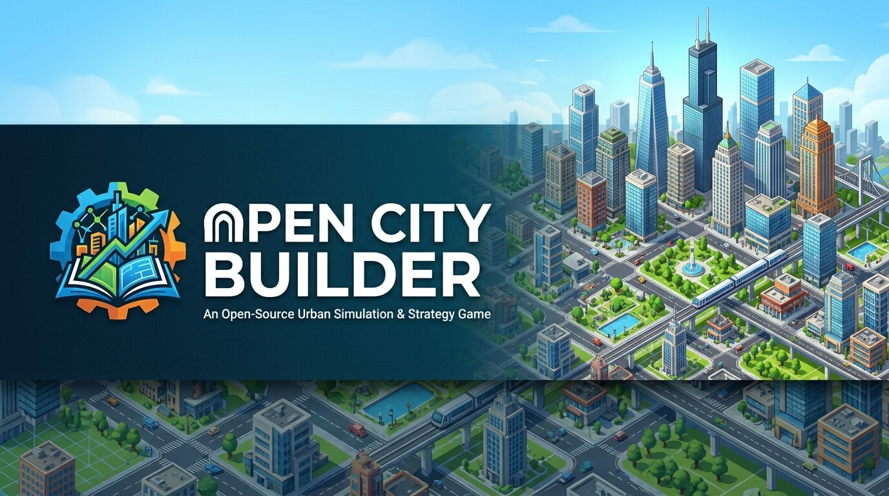

# Open City Builder

A decompilation of a classic 2003 city-building game, rebuilt function by function in C++ from its last PC release
(version 1.1.641), with the aim of running natively on Linux at any resolution and making the game easy to mod.

**Status:** early. Nothing playable yet. The native Linux build (`native/`) starts up, reads the game data and loads
most saved cities; there is no game window yet.

## You need your own copy

Open City Builder contains no game data, art, sound, text or executable code from the original. To build, verify or play
it you need your own legally purchased copy of the game (version 1.1.641, the current digital release). Nothing from
that copy may ever be added to this repository.

## How it works

1. Each function is rewritten in C++ next to the address it lives at in the original program.
2. A compare tool builds it with the original's compiler and checks it produces the same machine code.
3. While the work is in progress, a small loader swaps the rewritten functions into the original program, so the
   game stays playable and every rewritten function is tested in real play.
4. When every function is rewritten, the game builds from these sources alone. Then the Windows-specific parts are
   replaced, producing native Linux (and Windows) builds with modern display support.

## Two parts

- `src/`, `hook/`, `tools/`: the function-by-function rewrite of the PC release described above.
- `native/`: the route to a playable native Linux build. It is based on
  [DeSCAi4](https://github.com/CadenKalez/DeSCAi4) by CadenKalez and contributors, a C++20 decompilation of the
  later Mac release (GPLv3), with our Linux build and loading fixes on top. Its own README and notes are kept as they
  were upstream.

## Licence

GNU General Public License v3.0 (see `LICENSE`), as `native/` is GPLv3.

## Roadmap

Tooling → the open-source libraries the game used → the game's framework → engine → simulation → front end →
standalone build → native Linux → any resolution and UI scaling → releases → modding tools.
