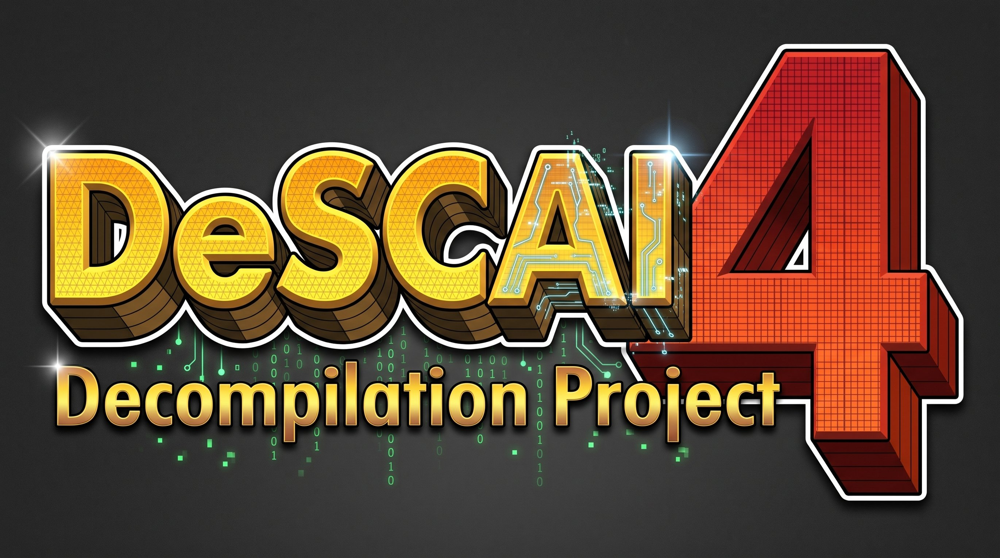

<p align="center">
  
</p>

# DeSCAi4

<!-- progress:start -->


`█████████████████░░░` **83.7%** — 22,495 of 26,880 game functions recovered, 4,385 remaining (details: [notes/progress.md](notes/progress.md))
 **84.5%** of the 26,597 functions the macOS port needs (22,485 recovered; 80% = 21,278)

[Coverage map](docs/coverage-map.svg): every class of the original as a box sized by its machine code, coloured by how far it has come
<!-- progress:end -->

A **hand-written C++20 decompilation of a 2003 city-building simulation game** (the retail macOS build, v1.2.1
build 185949), recovered one function at a time from its shipped x86_64 binary with Ghidra, plus a native macOS
host that runs it.

> **No game files are included.** You need your own legitimately obtained copy of the game. Its executable, its
> 1.2 GB of `GameData` and the Ghidra databases are never committed — only original source, notes and scripts live
> here. The game, its assets and its marks belong to their respective owners; this project is not affiliated with
> or endorsed by them.

**What this is not:** a patch, a reimplementation "inspired by" the game, or an emulator. Every function under
`src/sc4`, `src/gz`, `src/rz`, `src/s3d`, `src/lua`, `src/audio`, `src/html` is a transcription of the original
machine code into readable C++, keeping the original's object layout, calling convention, quirks and bugs.

## Contents

- [Status](#status)
- [What works today](#what-works-today)
- [What does not work yet](#what-does-not-work-yet)
- [How it works](#how-it-works)
- [Getting the game data](#getting-the-game-data)
- [Running the game](#running-the-game)
- [Other targets](#other-targets)
- [Tests](#tests)
- [Keeping the ledger honest](#keeping-the-ledger-honest)
- [Rebuilding the environment from scratch](#rebuilding-the-environment-from-scratch)
- [Rules for agents working here](#rules-for-agents-working-here)
- [Where the details live](#where-the-details-live)
- [Credits and legal](#credits-and-legal)

## Status

| | |
|---|---:|
| Game functions in the binary | 26,880 |
| Recovered (transcribed and tested) | **21,536 (80.1 %)** |
| Of which the macOS port needs | **21,526 of 26,597 (80.9 %)** |
| Classes complete | 1,099 of 1,700 |
| Registered tests | **412, all passing** |
| Source | 293,000 lines across 1,120 files |
| Ledger rows (each one address) | 27,877 |
| Seam interfaces (`I*Host`) | 307 |

The percentages are generated by `scripts/progress.py` and committed by the same script that produces the
badges above, so they cannot drift from the ledger.

**Two numbers, deliberately.** "Game functions" counts every function in the shipped binary. "macOS port"
subtracts 283 functions across 17 classes the port genuinely does not need — the Direct3D 7 backend Metal
replaces, the Win32 window manager the port re-implements, the embedded WWW/OLE browser, the screenshot album
and the Lua debugger UI. The list is explicit and auditable in [`scripts/macos_scope.py`](scripts/macos_scope.py),
with a written reason per class; nothing is excluded silently.

## What works today

- **A full boot against real game data.** `cSC4App` is 121 of 121 functions, and `build/boot_probe` now completes
  the whole spine — `PreFrameWorkInit` → `Init` (seven managers, **9 resource segments** mounted from the retail
  `.dat` packages) → `PostFrameWorkInit` → `Shutdown` — printing `[OK]` at every step.
- **City data.** `cSC4City` (123), the occupant manager (60), the DBPF resource manager (56) and the
  segment/stream classes read the retail `.dat` packages.
- **A running host that draws the game's own screens.** `src/experimental_host/` opens a Cocoa window, pumps events,
  provides the two pure-virtual platform methods the recovered window manager needs, and renders through the
  recovered software span engine. `build/sc4_host --game` boots the app spine against real game data, then shows
  the **splash window built from the game's UI script** and the **region screen's script toolbar** — both drawn by
  recovered code, not by the host.
- **The UI script chain.** `cGZUIScriptService`, `cGZScriptTerp`, `cGZScriptVocab`, `cGZScriptableControlSet` and
  all 21 `cGZLegacyControl::InterpretProperties*` interpreters, so a scripted window applies its image, text,
  colours and flags instead of coming up blank.
- **The 3D draw pass.** `cSC43DRender` (103 of 127) — the per-frame draw, the dirty-rectangle queue, the viewport
  rectangles and the backing store, with the exact driver call for each.
- **Simulation.** Demand, growth, tract and zone developers including the zoning pipeline that turns a drawn zone
  into lots, the terrain model with its texture pipeline, traffic network and automata, weather, aura, civic
  buildings, landfills and the region coupling.
- **412 tests**, one per class or subsystem, each built and run under `-fsanitize=address,undefined`.

## What does not work yet

- **A playable city.** Nothing drives `cSC4App::Run` with a renderer attached. `src/app/main.mm` is a standalone
  Metal viewer, not the game loop.
- **The game UI in full.** `cSC4View3DWin::AddGUI` — the 5.4 KB function that builds the game's 42 windows — needs
  three window procedures that are still unrecovered (`cSC4BudgetUIWinProc`, `cSC4GraphsViewWinProc`,
  `cSC4AdvisorPopupTracker`).
- **Models in the world.** The draw pass is recovered but its input queue is not: `RENDER3D-2`, the model and
  quad-grid change queue, is 24 functions.
- **Construction.** Around 45 recovered classes still have GZCOM creators that `return nullptr`, so the game's
  factory cannot build them; the tests construct them directly (`GZCOM-1`).
- **Seams.** 307 `I*Host` interfaces stand in for engine services. Most are implemented only by test fakes. Turning
  them into real adapters is integration work, not decompilation.
- **Loading a city into the running host.** The boot path mounts all 9 segments, but nothing yet drives
  `cSC4App`'s city-load into the view: that needs the 3D view, the renderer wiring and the panels below.

## How it works

| Part | Where | What it does |
|---|---|---|
| Recovered game code | `src/sc4`, `src/gz`, `src/rz`, `src/s3d`, `src/lua`, `src/audio`, `src/html` | One C++ definition per original address, the address in a comment above each function, the original field offsets documented |
| Bookkeeping | `notes/ledger.csv` | One row per binary address: symbol, unique name, source file, status, and how it was verified |
| Seams | `docs/SEAMS.md` | Every `I*Host` interface, the original vtable slot it stands for, and which class must eventually implement it |
| Progress and scope | `scripts/progress.py`, `scripts/macos_scope.py` | The percentages above, and the audited list of classes the macOS port does not need |
| Extraction | `scripts/export_class.py`, `scripts/vtable.py`, `scripts/dec_addrs.py` | Reads the class listing and vtables from the live Ghidra session |
| Tests | `scripts/run_tests.sh`, `scripts/run_tests_fast.py` | 412 tests; the fast runner caches objects per source and runs them in parallel (12 s warm, 276 s cold) |
| Host | `src/experimental_host/` | Cocoa window, event pump, window manager, CPU draw buffer and FreeType fonts — the platform layer the recovered code calls into. Marked EARLY TEST, with no ledger rows |
| Verification gates | `scripts/verify_class_done.py`, `check_unique_names.py`, `check_test_registry.py`, `scripts/hooks/` | Refuse a class whose ledger, test registration, seams or to-do rows are inconsistent; refuse a commit that shrinks the ledger or repeats a name |

A class is **not** considered done when it compiles. It is done when the ledger has one row per address, every row
names how it was verified, the test is registered and passing, every seam it introduces is documented, and
`verify_class_done.py` prints `ok`.

## Getting the game data

DeSCAi4 ships no game content. You need your own copy of **SimCity 4 Deluxe Edition for macOS** (the Steam version). The build
reads the game's `.dat` packages, fonts, sounds and the original executable (the byte-matching tools compare against it) from
a folder laid out like the app bundle's `Contents`. It looks in this order:

1. `$SC4_GAME_CONTENTS`, if set (the `Contents` folder, or any folder with `GameData/` inside)
2. `game/` in this repository
3. the Steam install, `~/Library/Application Support/Steam/steamapps/common/SimCity 4 Deluxe/Sim City 4 Deluxe Edition.app/Contents`

To keep a copy inside the repository (about 1.2 GB):

```bash
scripts/fetch_gamedata.sh
```

It copies `GameData/` and `MacOS/` from the Steam install into `game/`. To copy from somewhere else, pass that `Contents`
folder as its argument.

**Never push game data to GitHub.** The game's files are copyrighted. `game/`, `*.dat`, `*.sc4` and `*.fsh` are in
`.gitignore`, and the pre-commit hook refuses to commit them. Install the hook once per clone:

```bash
git config core.hooksPath scripts/hooks
```

## Running the game

```bash
NATIVE_OUT=$PWD/build/sc4_game python3 scripts/native_autolink.py scripts/native_game_link_list.txt src/app/game_main.mm 6
./build/sc4_game
```

The first command builds `build/sc4_game`. The second opens the game window at the region screen; click a city to open it.
To run a scripted session without a window, for example the region screen and a first city:

```bash
./build/sc4_game --script scenarios/first_city.txt
```

Set `SC4_SIMDEBUG=1` to print the simulation trace (the month ticks, the growth developers, the tract developer).

## Other targets

**The application spine, headless** — prints each startup step and stops at whichever one is missing:

```bash
./build/boot_probe
```

**The host, against real game data** — boots `cSC4App`, shows the splash built from the game's UI script, then the
region screen's script toolbar:

```bash
scripts/build_host.sh          # incremental; output build/sc4_host
./build/sc4_host --game
```

`--game` needs a real install with the Steam bundle layout (`Contents/GameData/*.dat`).

**The playable-window target** (3D and terrain through Metal, not the game loop):

```bash
scripts/build_app.sh release   # dev | release (-O3, ThinLTO) | debug (ASan/UBSan)
```

## Tests

The fast runner is the development loop; the shell script is the from-scratch reference run.

```bash
python3 scripts/run_tests_fast.py                       # all 412 tests, cached and parallel
python3 scripts/run_tests_fast.py sc4_city gz_wingrid   # just these
bash scripts/run_tests.sh                               # full rebuild, serial
python3 scripts/verify_class_done.py MyClass            # the definition-of-done gate for one class
python3 scripts/check_unique_names.py                   # names must be unique within their class
python3 scripts/check_test_registry.py                  # TESTS array lint: duplicates, quoting, missing files
python3 scripts/gen_remaining.py --check                # the remaining-functions report is current
```

Every test builds with `/usr/bin/clang++ -std=c++20 -Wall -Wextra -O1 -fsanitize=address,undefined`.

## Keeping the ledger honest

The ledger is the project's memory, and its credibility is the point. Three rules are enforced by script:

1. **A row is `recovered` only when the code exists and a test exercises it.** The oracle scripts and real game
   data count as verification too; `verify_class_done.py` accepts either.
2. **A function blocked on an unrecovered neighbour is `recovered-partial`**, with the neighbour named in its
   evidence. Partials count in the headline percentage and are distinguished everywhere else.
3. **Names are unique within a class**, descriptive, and never `sub_XXXX`.

Over-claims get reversed by construction rather than by luck: a class being recovered calls its neighbours, and a
caller that cannot link is proof the claim was false. This stretch alone reversed `RenderTile`, a 196-vs-52
`cSC4NetworkTool` count, and three `cSC4BuildingDevelopmentSimulator` predicates that turned out not to exist.

## Rebuilding the environment from scratch

The binary is x86_64, **not stripped, with intact C++ RTTI** — roughly 49.5k mangled symbols and 1,318 vtables,
which is what makes a readable decompilation possible at all.

**Toolchain (Homebrew):** Ghidra 12.1.4, OpenJDK 21, the GhidraMCP plugin 7.0.0 and its Python bridge.

1. `scripts/ghidra-gui.sh` launches Ghidra; open the project at `ghidra/projects/SC4.gpr`.
2. Enable the **GhidraMCPPlugin** in the project window (*File → Configure → Utility*), then open
   the game's executable in the CodeBrowser.
3. `scripts/check-mcp.sh` should report a connection at `http://127.0.0.1:8089`. The extraction scripts and every
   agent assume that server is running; none of them starts or stops Ghidra.
4. The project is imported, not auto-analysed: the symbols and vtables come from the binary itself, and each
   function is decompiled on demand.

Frameworks under `/System/Library/` are unresolved externals in the project. That is expected — there is no
x86_64 dyld shared cache on Apple silicon.

## Rules for agents working here

Several AI agents work in this checkout, sometimes at once. [`AGENT_RULES.md`](AGENT_RULES.md) is the contract; the
parts that matter most:

- **One writer for shared bookkeeping.** `notes/ledger.csv`, `notes/todo.csv`, `scripts/run_tests.sh` and
  `docs/SEAMS.md` change only through the scripts. Parallel agents leave `notes/ledger_pending/` and
  `scripts/tests/registry/` files and never commit.
- **Never fake a recovery.** If a neighbour is missing, seam it and say so; a `PARTIAL` row with a reason is worth
  more than a stub marked done.
- **Never hand-edit a generated file** (`docs/SEAMS.md`, `notes/progress.md`, the README progress block,
  `notes/remaining_functions.csv`).
- **Do not reuse a file name for a different helper**, and run the suite before committing a header other classes
  include.

Git hooks enforce the mechanical parts: a commit is refused if the ledger shrinks, a name repeats, the TESTS array
is malformed, or the message has no `Co-Authored-By:` trailer naming the tool that wrote it.

## Where the details live

| File | What it answers |
|---|---|
| [`notes/progress.md`](notes/progress.md) | The layer-by-layer breakdown behind the percentages |
| [`notes/ledger.csv`](notes/ledger.csv) | Every recovered address, its source and its verification |
| [`docs/SEAMS.md`](docs/SEAMS.md) | Every seam, what it stands for, who must implement it, and the quirks kept deliberately |
| [`notes/todo.csv`](notes/todo.csv) | Open work, blocked work and the reason for each |
| [`scripts/macos_scope.py`](scripts/macos_scope.py) | Why 283 functions are out of scope for the macOS port |
| [`notes/port_only_sources.md`](notes/port_only_sources.md) | Every source file no ledger row cites, and why (host, harness, generated tables) |
| [`AGENT_RULES.md`](AGENT_RULES.md) | The workflow and the definition of done |
| [`src/experimental_host/README_EARLY_TEST.md`](src/experimental_host/README_EARLY_TEST.md) | What the host is, what it stands in for, and what it proved about the recovered code |

## Credits and legal

- **Ghidra** and the **GhidraMCP** bridge do the analysis. The decompiler's output is a starting point, never the
  answer — most functions here were corrected against `otool` disassembly, and the ones that could not be stay
  marked partial rather than guessed.
- **The host** uses FreeType for fonts and macOS ImageIO as a stand-in for the publisher's image-decoder library,
  a third-party component outside the decompiled code. Every stand-in is labelled at its use site.
- **The game** and all of its assets remain the property of their respective rights holders. This repository
  contains no game code, assets or binaries taken from the retail package — only independent reimplementation,
  notes and tooling, for study and preservation. Use it only with a copy of the game you own.
